# Future Improvement Dependency Graph

```mermaid
flowchart TD
    PAL_01["PAL-01 Command Registry & Capability Model"]
    PAL_02["PAL-02 Command Palette Keyboard UX"]
    PAL_03["PAL-03 Quick Open Documents & Recent Items"]
    PAL_04["PAL-04 Command Palette & Quick Open Integration Hardening"]
    REV_01["REV-01 Review Session Domain & Baseline Contract"]
    REV_02["REV-02 Review Workspace Shell & Queue"]
    REV_03["REV-03 Review Diff Orchestration"]
    REV_04["REV-04 Review Approval & Commit Preparation"]
    REV_05["REV-05 Review Regression & Safety Hardening"]
    VIEW_01["VIEW-01 Saved View Domain & Query Snapshot"]
    VIEW_02["VIEW-02 Smart Collection Predicate & Membership"]
    VIEW_03["VIEW-03 Saved View & Smart Collection Canvas Objects"]
    VIEW_04["VIEW-04 Views & Collections Regression Hardening"]
    HLTH_01["HLTH-01 Health Report & Check Registry"]
    HLTH_02["HLTH-02 Markdown Health Checks"]
    HLTH_03["HLTH-03 DOCX Health & Consistency Checks"]
    HLTH_04["HLTH-04 Health UI & Safe Repair Routing"]
    HLTH_05["HLTH-05 Health Policy & Regression Hardening"]
    WS_01["WS-01 Work Session Domain & Persistence"]
    WS_02["WS-02 Work Session Resume & Context Restoration"]
    WS_03["WS-03 Work Session Activity Aggregation"]
    WS_04["WS-04 Work Session UX & Retention Hardening"]
    NOTE_01["NOTE-01 Canvas Note Domain & Persistence"]
    NOTE_02["NOTE-02 Canvas Note Object & Document Anchoring"]
    NOTE_03["NOTE-03 Note Editor, Status & Review Integration"]
    NOTE_04["NOTE-04 Note Search & Navigation Integration"]
    NOTE_05["NOTE-05 Canvas Note Regression & Release Hardening"]
    PAL_01 --> PAL_02
    PAL_01 --> PAL_03
    PAL_02 --> PAL_04
    PAL_03 --> PAL_04
    SCM_08 --> REV_01
    SCM_05 --> REV_01
    HIST_01 --> REV_01
    REV_01 --> REV_02
    REV_02 --> REV_03
    SCM_04 --> REV_03
    SCM_05 --> REV_03
    REV_03 --> REV_04
    SCM_06 --> REV_04
    REV_04 --> REV_05
    HIST_02 --> REV_05
    SRCH_05 --> VIEW_01
    CAN_08 --> VIEW_01
    VIEW_01 --> VIEW_02
    IDX_04 --> VIEW_02
    VIEW_02 --> VIEW_03
    CAN_07 --> VIEW_03
    VIEW_03 --> VIEW_04
    SRCH_03 --> VIEW_04
    SRCH_04 --> VIEW_04
    IDX_06 --> HLTH_01
    FS_06 --> HLTH_01
    HLTH_01 --> HLTH_02
    MD_04 --> HLTH_02
    HLTH_01 --> HLTH_03
    DOCX_04 --> HLTH_03
    HLTH_02 --> HLTH_04
    HLTH_03 --> HLTH_04
    BAT_03 --> HLTH_04
    HLTH_04 --> HLTH_05
    QA_01 --> HLTH_05
    HIST_02 --> WS_01
    CAN_06 --> WS_01
    SCM_09 --> WS_01
    WS_01 --> WS_02
    WS_01 --> WS_03
    SCM_08 --> WS_03
    REV_02 --> WS_03
    WS_02 --> WS_04
    WS_03 --> WS_04
    CAN_06 --> NOTE_01
    FND_03 --> NOTE_01
    NOTE_01 --> NOTE_02
    CAN_07 --> NOTE_02
    NOTE_02 --> NOTE_03
    REV_02 --> NOTE_03
    NOTE_03 --> NOTE_04
    SRCH_05 --> NOTE_04
    NOTE_04 --> NOTE_05
    QA_06 --> NOTE_05
```

## Notes

- Cross-version dependencies are intentional where a later feature builds on an earlier user workflow.
- V1 dependencies remain references to already-existing V1 capabilities.
- This graph is advisory until a roadmap version is promoted into the active sprint manifest.
